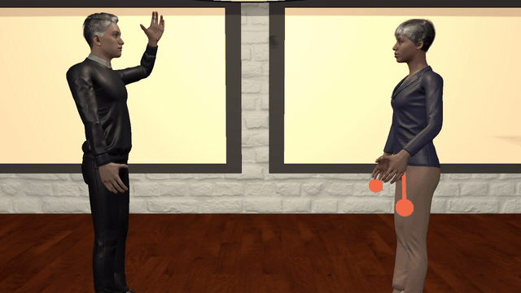
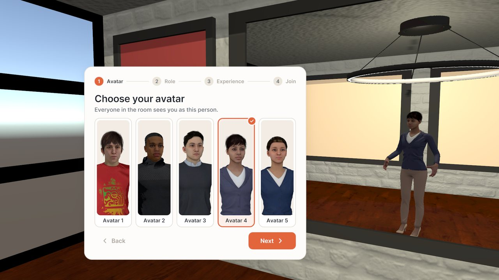
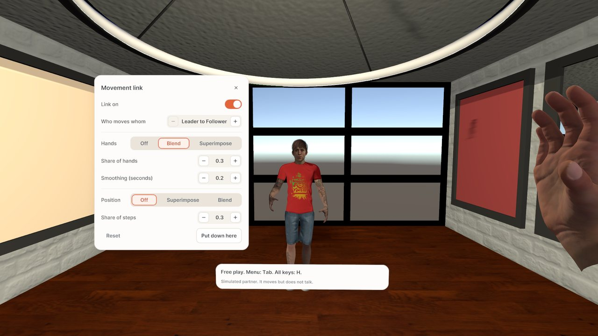
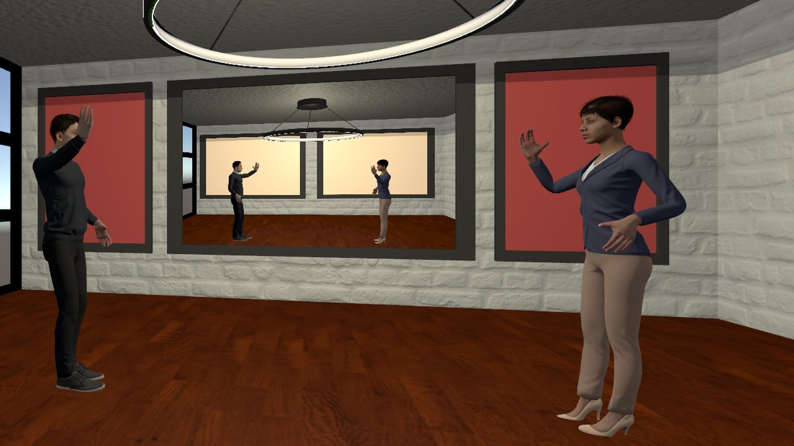
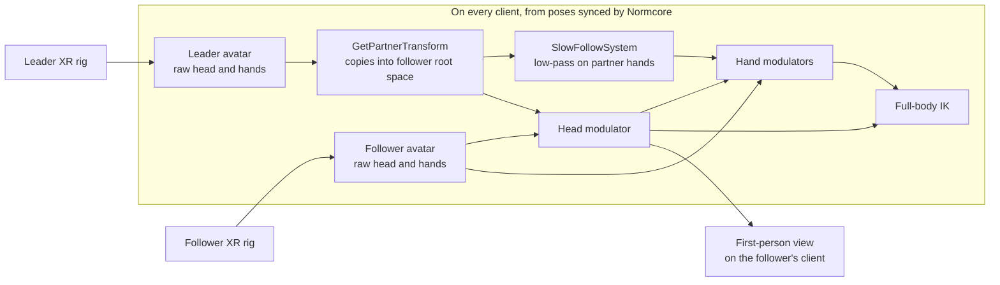

# Social Leading VR

A Unity platform for social VR with real-time movement coupling: two people meet in one room, and a share of one person's movement flows into the other person's avatar.




*The scene `DesktopDemo` with two simulated users. Left: the leader. Right: the follower. The orange markers show where the follower's tracked hands are; the avatar's hands show the coupled result.*

[All-in-One](docs/ALL_IN_ONE.md) | [Architecture](docs/ARCHITECTURE.md) | [Components](docs/COMPONENTS.md) | [VR setup](docs/VR_SETUP.md) | [Customize](docs/CUSTOMIZE.md) | [Third-party notices](THIRD_PARTY_NOTICES.md) | [Changelog](CHANGELOG.md)

## What it does

- **Couples movement live.** The Follower's avatar shows a mix of the Follower's own movement and the Leader's. Hands, and steps through the room, can be blended or superimposed, with a share from 0 to 1. In free play the people in the room can change it while it runs.
- **Keeps it spatially correct.** Hands are compared relative to each head and turned around the vertical axis, so "forward" for the Leader becomes "forward" for the Follower. A low-pass filter smooths the Leader's hands.
- **Shows it on full bodies.** Five humanoid avatars with inverse kinematics. The Follower looks out of the coupled head, so shared steps are felt in the view too.
- **Puts people in one room.** Normcore carries raw poses, voice, and everybody's choices. Every client computes the coupling itself.
- **Is complete inside VR.** Everybody starts the same app, whatever their role, and chooses avatar, role, and what the room runs on panels in the headset.
- **Runs guided sessions.** A session with narration, boards, shared activities, in-VR answers, and a timer is one data asset. It steps by itself, or an operator steps it.

## All-in-One

One scene brings the platform together. Build it once, start it on every device, and choose the rest inside. The app never has to be restarted, people can come and go, and alone it needs no network and no account.

| You choose | Options, default in bold |
|---|---|
| Avatar | One of five. Your body, your mirror image, and what everybody else sees change together |
| Role | **Leader**, Follower, or assigned at random |
| Experience | **Free play**, or a full session with narration, boards, shared activities, in-VR answers, and a timer |
| Control of a session | **Automatic**, or an operator who steps it from a panel |
| Pace of a session | **Full length, about 13 minutes**, or a quick preview of about 6 minutes |
| Company | Room **1** to 9 with other people, alone with a simulated partner, or as operator |
| Link in free play | **On** or off; **Leader to Follower**, Follower to Leader, both ways, nobody |
| Hands in free play | Off, **blend**, superimpose; share **0.3**; smoothing **0.2 s** |
| Position in free play | **Off**, superimpose, blend; share **0.3** |
| In the room | Microphone, captions, recentre, delete my answers, leave |

| Choose an avatar | Change the link while you play |
|---|---|
|  |  |



*Two people in one online room, seen by a third client. Three processes on one PC, connected through the Normcore service.*

How it is used, how avatars and roles stay the same for everybody, and how to change the session: [docs/ALL_IN_ONE.md](docs/ALL_IN_ONE.md).

## Quick start

### On a desktop, without a headset

Playing alone needs no Normcore account, app key, or network.

1. Install **Unity 2022.3.15f1** (Unity Hub > Installs > Install Editor > Archive).
2. `git clone https://github.com/JiahaoLiu5/social-leading-vr.git` (about 520 MB of files).
3. In Unity Hub choose *Add project from disk*, select the folder, and open it. Stay online while Unity downloads the packages; the first import takes several minutes. If a Normcore window appears, close it.
4. Open `Assets/For Demo/Scenes/AllInOne.unity` and press **Play**. Without a headset the Console may show OpenXR messages; the scene continues.
5. Go through the panel with the mouse: an avatar, **Follower**, **Free play**, and on the last page **Solo with a simulated partner**.
6. The simulated Leader moves, and your avatar's hands take on a share of its movement. Hold the right mouse button and look at the mirror. Press **L** to change the link, **1** to **7** to move your own hands, **Tab** for the menu, **H** for all keys. The scene `DesktopDemo` shows the coupling from outside, with every value on the screen.

### In VR

1. Install **Android Build Support** for the editor and switch the build target to Android. OpenXR with Meta Quest Support is already on in this project.
2. Run **Social Leading > All-in-One > Build Android**, then `adb install -r Builds/AllInOne-Android/SocialLeadingVR-AllInOne.apk`. Or press **Play** with the headset linked to the PC.
3. Point at a panel with a controller and press the trigger. In a room, **Y** on the left controller opens the menu.

### Together with other people

1. Create an app at [normcore.io](https://normcore.io), copy its key, and paste it into `Assets/Normal/Resources/NormcoreAppSettings.asset`. Keep the key out of git:

   ```sh
   git update-index --skip-worktree Assets/Normal/Resources/NormcoreAppSettings.asset
   ```

2. Build again. **A build contains your key, so do not publish it.**
3. Start the app on each device, choose the same room number, and press **Join room ... online**.

Settings, permissions, Quest 3, and troubleshooting: [docs/VR_SETUP.md](docs/VR_SETUP.md).

## How it works

### Movement link



All vectors are local to each user's own avatar root. `F` is the follower, `L` the leader, `*` marks the displayed pose, and `r` is the share. `axisRatio` scales `r` per axis in hands blend.

```text
own      = hand_F - head_F
partner  = Yaw(heading_L -> heading_F) * (LowPass(hand_L) - head_L)

hands, blend         hand* = head* + Lerp(own, partner, r)
hands, superimpose   hand* = head* + own + sum over frames of r * Yaw * change of (hand_L - head_L)

position, superimpose   head*.xz = head_F.xz + r * (head_L(t) - head_L(t0)).xz
position, blend         head*.xz = Lerp(head_F.xz, head_L.xz, r)

LowPass: x += (target - x) * (1 - exp(-dt / tau))
```

`t0` is the moment the link starts. Head height and all rotations stay the user's own; hand height is coupled like the other two axes. A source is always read in its raw pose, so two avatars that move each other ("both ways") do not feed back.

In the All-in-One scene nothing switches at once: a new share is reached in 0.7 s, and a new source or mode first goes through share 0. Update order and details: [docs/ARCHITECTURE.md](docs/ARCHITECTURE.md).

### Avatar sync

Your avatar is not a local setting. Avatar, role, and ready state (in the lobby or in the room) are properties of your networked player. When you pick an avatar, your client writes the avatar's id, a number, there. Every client, yours included, then dresses your body from that id and the same catalog, so what you see in the mirror is what everybody else sees. The properties stay in the room, so a person who joins later dresses everybody in the same way. When two people ask for the same role at the same moment, every client applies the same rule to the same data and reaches the same answer. Details: [docs/ALL_IN_ONE.md](docs/ALL_IN_ONE.md#avatars-and-roles-for-everybody).

### Session as data

What runs, which step, and the room time at which the step began are shared properties too. Narration, captions, boards, panels, and timers follow from step and start time. A late joiner hears the narration from the right second, and when the client that advances the steps disappears, another one takes over.

## Scenes

### For Demo

All in `Assets/For Demo/Scenes`.

| Scene | What it shows |
|---|---|
| `AllInOne` | Everything above in one app, with panels inside VR |
| `DesktopDemo` | The coupling seen from outside: two simulated users, markers for the tracked hands, an orbit camera, no network |
| `Leader/SLSL_P1` to `SLSL_P5` | One headset as Leader, one scene per avatar |
| `Follower/SLSF_P1` to `SLSF_P5` | One headset as Follower, one scene per avatar |
| `Monitor/Monitor` | The operator's PC for these headset scenes: Space steps a 13-step session shell with placeholder panels and empty clip slots, and a 50 Hz motion log is written |

### For Study

Systems like this one are built to serve research. The original scenes of research made with it are kept for the record in `Assets/For Study`, unchanged.

## Build on it

Coupling, avatars, networking, and session are separate parts, so the project can serve as a base for other social VR work.

- **Guided movement.** Raise the share and mirror the hands: one person's movement becomes a guide for the other, as in coaching, dance, or rehabilitation prototypes.
- **Transformed nonverbal behaviour.** Scale single axes, superimpose instead of blend, or link only one hand, and compare the results side by side.
- **Adaptive coupling.** Change a `ModulationProfile` or the link settings of the session from your own script, for example from speech, gaze, or distance.
- **Your own two-person activity.** Replace the steps of the session asset. Networking, avatars, late joining, operator, and simulated partner stay.

## Make it yours

`Content` is the folder `Assets/For Demo/AllInOne/Content`. Recipes: [docs/CUSTOMIZE.md](docs/CUSTOMIZE.md). Every script and field: [docs/COMPONENTS.md](docs/COMPONENTS.md).

| Change | Where | Options and defaults |
|---|---|---|
| Start values of free play | `Content/Free Play Profile.asset` | Hands blend 0.3, position off, smoothing 0.2 s |
| Link of the full session | `Content/Study Profile.asset` | Hands blend 0.3, position superimpose 0.3, smoothing 0.2 s |
| Who moves whom | `Content/Topology Catalog.asset` | Four entries, one source role per role |
| Roles and seats | `Content/Role Catalog.asset` | Leader and Follower, 3 m apart, facing each other |
| Avatars | `Content/Avatar Catalog.asset` | Five characters, loaded on demand |
| Steps, narration, captions, times | `Content/Dyad Study Script.asset` | 13 steps; per step clip, captions, hint, time, rule, timer, cues |
| Texts, rooms, places | `Content/App Config.asset` | Nine rooms, places of the lobby, the operator, and the panels |
| Coupling in a single-role scene | `ModulationProfileApplier` and a `ModulationProfile` on the avatar root | Modes, share, share per axis, each hand, offset limit, smoothing |
| How movement is mixed | [`Scripts/Modulation`](Assets/For%20Demo/Scripts/Modulation) | One script per rule |
| Session shell of the monitor | `MovementTriggers`, `MovementStateHandler`, `UIPlayerInput` | 13 positions, 13 empty clip slots, placeholder panels |

## Project layout

```text
Assets/For Demo/
  Scenes/             AllInOne, DesktopDemo, Leader/, Follower/, Monitor/
  AllInOne/           integrated demo: scripts, content, prefabs, scene builder, builds, tests
  DemoKit/            panels, pointers, captions, and a desktop body, made in code
  Scripts/            Avatar, Logging, Modulation, Session, TaskUI
  Prefabs/            networked avatars (P1..P5, Leader and Follower), Realtime objects, XR rigs
  Characters/ UI/     IK prefabs of the five characters; in-VR panels
  DesktopDemo/        profile, scripts, and builder of the desktop demo
Assets/For Study/     original research scenes; All-in-One plays their narration
Assets/Shared/        character models, hand poses, room, mirror, camera, panel parts
Assets/Normal/        Normcore settings (the app key is empty)
Assets/Samples/       XR Interaction Toolkit starter assets (four added input actions)
Assets/ThirdParty/ XR/ XRI/ Plugins/   TextMesh Pro; OpenXR, XRI, and Android settings
docs/                 all-in-one, architecture, components, VR setup, recipes
```

## Requirements

| Item | Version |
|---|---|
| Unity | 2022.3.15f1, built-in render pipeline, Android Build Support for Quest builds |
| Normcore (`com.normalvr.normcore`) | 2.12.0, from the Normal scoped registry in `Packages/manifest.json` |
| XR Interaction Toolkit / OpenXR Plugin / XR Plug-in Management | 2.5.4 / 1.9.1 / 4.5.0 |
| Animation Rigging / Input System / TextMesh Pro / Unity UI | 1.2.1 / 1.7.0 / 3.0.6 / 1.0.0 |
| Headset | Quest with Touch controllers; hand tracking is not used |
| Service | A Normcore account with an app key, only for rooms with other people |
| Disk | About 520 MB of assets, of which 490 MB are the five character models, plus the Unity `Library` folder |

## Privacy

Online rooms send movement, voice, and choices through the servers of Normal, the company behind Normcore. Read its terms and tell everyone who joins. In the All-in-One scene the microphone is opened when you connect to an online room and stays muted until you enter; an operator stays muted until they switch on **Talk to the room**. Solo opens no microphone and uses no network. Everybody who has your app key can join your rooms. Answers given in a session stay in one file on the device and can be deleted in the app. In the single-role scenes the monitor writes head and hand movement, and the headsets write answers, to local CSV files; treat them as personal data.

## Known limits

- **Testing.** All checks of this release were made on one Windows PC. In the Unity Editor the automated tests of the All-in-One scene pass, with mouse and keyboard and with a simulated headset. Online rooms were tested with two or three processes on that PC and the real Normcore service, not between different machines. **Nothing of the All-in-One scene was run on a headset**: the APK was built but not installed, so frame rate, comfort, readability, and controllers are unverified there. **Voice between people was not heard**, because the microphones stayed closed in all tests. The single-role headset scenes were not run again.
- Coupled poses are computed on each client from the synced raw poses, so two clients can show slightly different results.
- Position coupling moves the Follower's viewpoint without the Follower moving. Start with a low share, and stop if a user feels unwell. Free play limits the offset to 0.6 m; the full session and the single-role scenes do not limit it.
- Two people have a role; others can watch. Somebody who watches must leave and join again to take a role that becomes free.
- Every user starts with the eyes at 1.6 m. There is no hand tracking, gaze, or facial animation.
- The single-role scenes all join one room name, switch the link off without a fade, and play no narration on a client that joins after the first step.
- OpenXR 1.9.1 does not list Quest 3 as a target device. See [docs/VR_SETUP.md](docs/VR_SETUP.md#quest-3).

## Credits

System design and lead development: Jiahao Liu. Code contributions: Zewuzi Meng (session flow and task UI), Lydia Lin (avatar rigging), Stella Dong. Built in the Virtual Embodiment Lab, Cornell University, directed by Andrea Stevenson Won. More projects: [jiahaoliu5.github.io/projects](https://jiahaoliu5.github.io/projects/).

## Licence and third-party assets

The source code in this repository is under the [MIT licence](LICENSE). The licence does not cover third-party assets: avatars, room model, narration, fonts, Unity samples, and packages keep their own terms. Read [THIRD_PARTY_NOTICES.md](THIRD_PARTY_NOTICES.md) before you redistribute anything.

## Cite

Use [CITATION.cff](CITATION.cff), or *Cite this repository* on GitHub:

> Liu, J. (2026). *Social Leading VR* (version 1.1.0) [Computer software]. https://github.com/JiahaoLiu5/social-leading-vr
