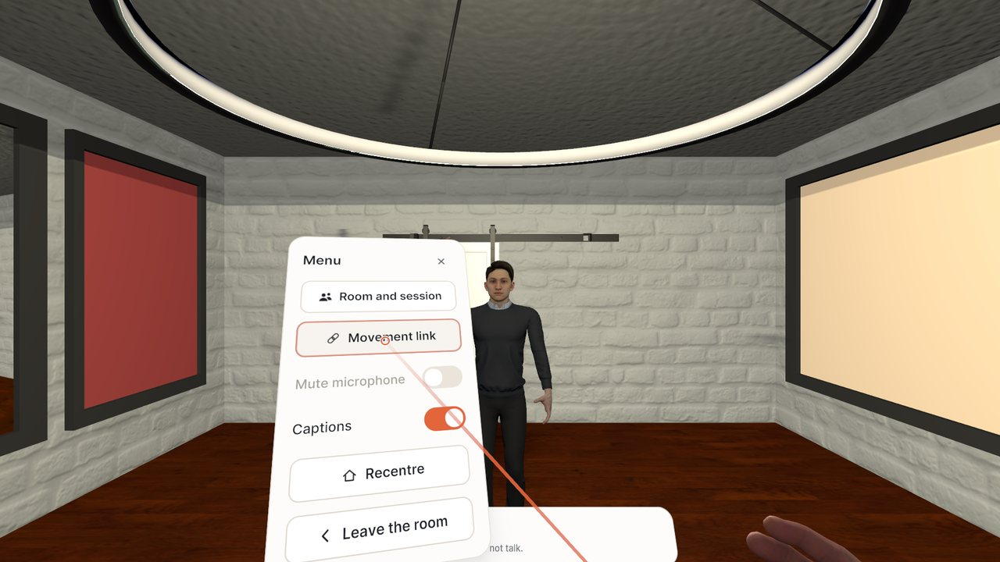
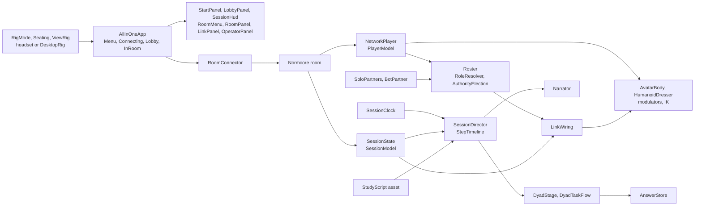

# All-in-One

`Assets/For Demo/Scenes/AllInOne.unity` is the integrated demo: one app for everybody, whatever their role. Avatar, role, experience, room, and the movement link are all chosen inside VR, and people can come, go, and change their minds without a restart. This page explains how it is used, how it works, and how to extend it. The coupling itself is described in [ARCHITECTURE.md](ARCHITECTURE.md).

Contents: [User flow](#user-flow), [Panels](#panels), [Avatars and roles for everybody](#avatars-and-roles-for-everybody), [Joining and leaving](#joining-and-leaving), [Simulated partners](#simulated-partners), [Free play and the link](#free-play-and-the-link), [Session as data](#session-as-data), [Automatic or operator](#automatic-or-operator), [Answers stay on the device](#answers-stay-on-the-device), [View, mirror, and quality](#view-mirror-and-quality), [Builds](#builds), [Networked tests](#networked-tests), [Automated tests](#automated-tests), [Architecture of the folder](#architecture-of-the-folder), [Controls](#controls), [What was tested](#what-was-tested).

## User flow

1. **Avatar.** Five cards with pictures. Your own body stands in front of the mirror and changes at once.
2. **Role.** Leader, Follower, or **Assign at random**. A Leader's avatar moves exactly as the user does; a Follower's avatar adds a share of the Leader's movement.
3. **Experience.** **Free play**, or a **Full session**. A full session also asks for the control (**Automatic** or **Operator**) and the pace (full length, labelled **Study timing**, or **Quick preview**).
4. **Join.** Room 1 to 9 and **Join room ... online** (needs an app key), **Solo with a simulated partner**, or **Join as operator**, which offers **Operate room ...** and **Rehearse alone**.
5. **Lobby**, online participants only. It shows who is in the room, marks the roles that others have, tells what the room runs, and still lets you change avatar and role. **Enter** takes you in.
6. **Room.** The view fades, and you stand at the seat of your role: the Leader at (0, 0, -1.5) facing +z, the Follower 3 m away facing back. Every user starts with the eyes at 1.6 m.
7. **Leave** from the menu (or Esc on a desktop). The start panel comes back with your last choices. No scene is loaded again.

The first person who enters an idle room decides what it runs. Everybody who comes later joins what is there; a message says so when their own choice was different. Solo and operators skip the lobby.

## Panels

| Panel | Contents |
|---|---|
| `start` | The four pages Avatar, Role, Experience, Join, and **Delete my answers** when there are any |
| `lobby` | Room status, people, role cards with taken roles marked, avatar cards, **Enter**, **Leave**. After a finished session also **Run the session again** and **Start free play** |
| `hud`, the session bar | A slim bar at the lower edge of the view: step, a short hint, a timer, **I am done**, **Pause** (solo), waiting messages. After the end **Return to menu**, **Run it again**, **Stay and play**. In free play it shows where the menu is, for ten seconds |
| `menu` | **Room and session**, **Movement link** (free play), **Mute microphone**, **Captions**, **Recentre**, **Delete my answers**, **Leave the room** |
| `room` | People in the room, own avatar and role, what runs (free play or full session), control, pace, **Start ... for everybody** |
| `link` | The link of free play, see [below](#free-play-and-the-link). **Put down here** leaves it standing in the room |
| `op` | The operator's panel, see [Automatic or operator](#automatic-or-operator) |
| Task panels | Private panels of a session step, in front of each user |
| Captions, toasts | Narration text above the session bar, short messages |

In a headset the menu and its pages hang 22 cm in front of the left controller and are used with the right ray; the left ray is off while a page hangs there. On a desktop they stand at the left of the view. All panels are made in code with the [DemoKit](ARCHITECTURE.md#demokit) and belong to one user: the mirror camera leaves out their layer, and nothing of them is networked.



*The menu on the left hand, from a test with a simulated headset and controllers.*

## Avatars and roles for everybody

Each person in an online room is one networked object, `Demo AllInOne Player`, the same prefab for every role and avatar. Its data is a Normcore model that only the owner writes:

| Property of `PlayerModel` | Meaning |
|---|---|
| `avatarId` | Index in `Avatar Catalog`, -1 = none |
| `role` | The role this person asks for, -1 = none |
| `kind` | Participant, operator, or spectator |
| `phase` | Ready state: 0 in the lobby, 1 in the room |
| `doneMark` | The last step this person finished |
| `userKey`, `connection` | A random key per app start, and a counter of its connects |
| `muted` | Voice off |
| `handPose` | Trigger and grip of both hands, unreliable and at most 20 times per second |

**Avatars.** Choosing an avatar writes `avatarId`. Every client, the owner's included, reacts to the change in the same way: [`NetworkPlayer`](../Assets/For%20Demo/AllInOne/Scripts/Core/Net/NetworkPlayer.cs) calls `AvatarBody.SetAvatar`, and [`HumanoidDresser`](../Assets/For%20Demo/AllInOne/Scripts/Dyad/HumanoidDresser.cs) loads the character from `Resources/AllInOne/Characters` and wires its IK to the displayed head and hands. The user's own body, the mirror image, and every other client therefore show the same choice; nobody dresses a body from a local setting. The old character stays until the new one is loaded, and a newer request wins over an older one. The defaults are -1, so a client that sees a player before its values arrive shows nothing rather than a wrong avatar. A late joiner receives the current values of every model and dresses everybody from them. Only in the menu, before connecting, is a local preview body dressed directly.

**Roles.** The role that counts is computed, not stored. [`RoleResolver`](../Assets/For%20Demo/AllInOne/Scripts/Core/Net/RoleResolver.cs) is a pure function of the players' data, so every client reaches the same result in any order:

1. Leftovers of a crashed or sleeping client are dropped: a player whose `userKey` appears again with a higher `connection`.
2. In order of the client id, each participant in the room gets the role asked for, if it is still free.
3. The others get the next free role. When none is free, they watch (role -1).

A client whose wish lost writes the resolved role into its own model and says so: "Leader was already taken. You are the Follower." The role sets the seat, the tag of the avatar root, and who moves whom. Avatar and role can be changed in the lobby and in free play; the avatar also while a session waits for its start.

## Joining and leaving

[`RoomConnector`](../Assets/For%20Demo/AllInOne/Scripts/Core/Net/RoomConnector.cs) joins online rooms named `sl-dyad-aio1-r1` to `sl-dyad-aio1-r9` (prefix in `App Config`; raise its number when a model changes, so that old and new builds never meet). Solo is a Normcore room in offline mode, opened with placeholder values, so neither the app key nor the network is used.

- **Connecting** fails after 20 s, or at once when the server reports an error. The start panel then says "The room could not be reached."
- **A lost connection** brings the user back to the start panel with a message. Joining again counts up `connection`, so the leftover of the old connection gives up its role.
- **Leaving** fades the view, disconnects, and waits until Normcore has removed the players before the next connect is allowed.
- **A partner who enters or leaves** is announced. A session goes on without the one who left, and the bar says so.
- **An online automatic session** starts its countdown when both roles are filled. Until then the bar offers **Start in solo instead**.
- **Somebody who watches** stays muted and must leave and join again to take a role that becomes free.

## Simulated partners

In solo, [`SoloPartners`](../Assets/For%20Demo/AllInOne/Scripts/Core/Solo/SoloPartners.cs) fills every role except yours with a [`BotPartner`](../Assets/For%20Demo/AllInOne/Scripts/Core/Solo/BotPartner.cs); an operator who rehearses alone gets one for each role. A simulated partner is a local copy of the player body without network components. It counts as a participant, wears an avatar that differs from yours, and never talks or advances a session.

- **Free play.** A simulated Leader shows a movement every five seconds: waving, raising the hands, talking gestures, reaching. A simulated Follower stands still, so the link is easy to see on it.
- **Full session.** Each step lists cues for it: where to stand (its seat, near the user, facing the mirror, at a board) and which movement to make, by the second. It walks by moving its root, which the link does not see.
- **Done.** It is done with a step 1.5 s after you at the earliest; in steps with task panels also not before a time set in the step.

Its movement comes from [`SimulatedRig`](../Assets/For%20Demo/DesktopDemo/Scripts/SimulatedRig.cs), the same script as in the desktop demo.

## Free play and the link

In free play the link is part of the shared session model, so every change on the `link` page reaches everybody in the room, and every client computes the result for itself.

| Setting | Options, default in bold | Effect |
|---|---|---|
| Link on | **on**, off | Off: every avatar shows its own movement only |
| Who moves whom | **Leader to Follower**, Follower to Leader, Both ways, Nobody | Entries of `Topology Catalog`: one source role per role |
| Hands | Off, **Blend**, Superimpose | See the formulas in the [README](../README.md#movement-link) |
| Share of hands | 0 to 1 in steps of 0.1, **0.3** | |
| Smoothing | 0 to 1 s in steps of 0.1, **0.2** | Time constant of the low-pass on the source's hands |
| Position | **Off**, Superimpose, Blend | Moves the avatar, and with it the view, by a share of the source's steps |
| Share of steps | 0 to 1 in steps of 0.1, **0.3** | |
| Reset | | Back to `Free Play Profile` |

[`LinkWiring`](../Assets/For%20Demo/AllInOne/Scripts/Core/Link/LinkWiring.cs) gives every body its source and a profile of its own. It never switches at once: a share moves to its new value in 0.7 s whatever the distance, and a new source or mode first ramps the share to 0, then changes, then ramps up. A position offset that is no longer wanted fades out smoothly (time constant 0.4 s) instead of vanishing in one frame, and a displacement of the source faster than 6 m/s (a recentre) is not added. Free play limits the position offset to 0.6 m and a superimposed hand offset to 0.5 m.

In a full session the link is fixed: Leader to Follower, with the values of `Study Profile` (hands blend 0.3, position superimpose 0.3, smoothing 0.2 s). The `link` page is then not offered.

## Session as data

The full session is the asset [`Content/Dyad Study Script.asset`](../Assets/For%20Demo/AllInOne/Content/Dyad%20Study%20Script.asset) (class [`StudyScript`](../Assets/For%20Demo/AllInOne/Scripts/Core/Study/StudyScript.cs)): 13 steps with narration, boards, shared activities, in-VR answers, and a timer. Only a few numbers are shared:

| Property of `SessionModel` | Meaning |
|---|---|
| `experience`, `director`, `pace` | What runs, who steps it, how long it takes |
| `step`, `stepStartTime` | The running step (-1 before the first) and the room time at which it began |
| `paused`, `pauseTime` | A pause shifts `stepStartTime` when it ends |
| `sessionId`, `repeatCount` | Count starts and repeats, so that no old answer or "done" counts for a new run |
| `seed` | A random number per start; simulated partners choose their avatars with it |
| `linkOn`, `topology`, `handMode`, `handRatio`, `smoothing`, `positionMode`, `positionRatio` | The link of free play |

Nobody owns this model; the rules about who may write what are all in [`SessionState`](../Assets/For%20Demo/AllInOne/Scripts/Core/Net/SessionState.cs). On every client [`StepTimeline`](../Assets/For%20Demo/AllInOne/Scripts/Core/Study/StepTimeline.cs) turns step, start time, and the room clock into a phase:

```text
before the first step   Waiting, or Countdown to the scheduled start
t = now - stepStartTime
t < clip length         Narration
t < clip length + W     Response    (W = response time of the step at this pace)
afterwards              Gap, then the next step
after the last step     Finished
```

Narration, captions, boards, task panels, the bar, and the timer are derived from that phase every frame, never from events. A client that joins late is therefore in the right place at once, and the narration starts at the right second.

### Fields of a step

| Field | Use |
|---|---|
| `id`, `title` | Name in the operator's list |
| `clip`, `captions` | Narration and its text, each piece with the second at which it is spoken |
| `hint` | One line in the session bar |
| `responseSeconds`, `quickSeconds` | Time after the clip at full length and in the quick preview; -1 = a fifth of the full time, 3 to 10 s |
| `rule`, `minResponseSeconds` | `Time`: the step ends when its time is over. `TimeOrAllDone`: also earlier, when everybody is done. `AllDone`: when everybody is done, with the time as a limit |
| `showTimer` | A countdown in the bar |
| `cues` | Names that the stage of the project understands: boards on the wall, private task panels, a raised hand |
| `bots`, `botDoneSeconds` | What simulated partners do, and when they are done |
| `usualShare` | Only for the duration shown on the start panel |

Countdown (5 s, quick 3 s) and the gap between steps (1 s, quick 0.5 s) are fields of the asset itself. A user is done with a task by answering it, and in a `TimeOrAllDone` step with **I am done**.

### Add or change a step

1. Select `Content/Dyad Study Script.asset` and edit the list in the Inspector: drop in a clip, write the captions with their seconds, set hint, times, and rule. The number of steps is not fixed anywhere else.
2. A step that only uses existing cues needs no code. A new cue is a new name in `cues` and a few lines in a [`StudyStage`](../Assets/For%20Demo/AllInOne/Scripts/Core/Study/StudyStage.cs) subclass, which shows or hides things from the step alone; [`DyadStage`](../Assets/For%20Demo/AllInOne/Scripts/Dyad/DyadStage.cs) is the example.
3. The menu command **Rebuild Scene** writes the content assets again from [`AllInOneBuilder.Content.cs`](../Assets/For%20Demo/AllInOne/Editor/AllInOneBuilder.Content.cs). Make lasting changes there, or do not rebuild.
4. The automated test checks the shipped steps (count, clip lengths, times) in `AllInOneSmokeTest.Static.cs`. Adapt it with your content.

## Automatic or operator

**Automatic** (the default). One client advances the steps: the participant with the lowest client id. Operators, spectators, simulated partners, and leftovers never do. A newly elected client waits 1 s before it acts, so two clients never act during a hand-over. It schedules the first step when both roles are filled, ends each step by the rule of the step, and writes the next step only if the step is still the one it saw, so a double advance is harmless. In solo the user's own client always acts.

**Operator.** An operator joins with no visible body and a muted microphone, and sees the `op` panel: people with role, avatar, and "done", the list of steps with the current one marked, and the time in the step.

| Control | Action |
|---|---|
| **Next step** (desktop: Space) | Refused while the narration plays, as on the monitor of the single-role scenes. Reads **Start step 1** before the first step and **Finish** on the last one |
| **Start**, **End** | Start a session for the room, end it |
| **Repeat** (R), **Pause** (P) | Repeat the step from its start; pause and continue |
| Pace | Before the start |
| **Take control**, **Automatic** | Take an automatic session over, or give it back |
| **Talk to the room**, **Mute narration** | Own microphone; narration on this client |
| **Move to hand** | In a headset: the panel moves to the left controller |

When a session waits for an operator who is not there, or the operator left, the bar offers **Switch to automatic** to every participant.

| Who may | When |
|---|---|
| Change avatar | In the lobby, in free play, and while a session waits |
| Change role | In the lobby and in free play, free roles only |
| Start free play or a session for everybody | Participants in free play, while waiting, after the end; operators always |
| Choose automatic or operator | Anybody before the first step; later an operator, or a participant when no operator is in the room |
| Change the pace | Before the first step |
| Change the link | Participants and operators, in free play |
| Step, repeat, pause, end | The operator, while the session is in operator mode. In solo the user can pause |

## Answers stay on the device

Answers given on task panels are appended to `all-in-one-answers.csv` in `Application.persistentDataPath` (columns `Time`, `Session`, `Answer`, `Value`) by [`AnswerStore`](../Assets/For%20Demo/AllInOne/Scripts/Core/App/AnswerStore.cs). They are never sent. **Delete my answers** on the start panel, in the menu, and at the end of a session removes the file. The tests write to their own folder.

## View, mirror, and quality

- **Seat.** [`Seating`](../Assets/For%20Demo/AllInOne/Scripts/Core/View/Seating.cs) gives the rig root the exact pose of the seat, because the link adds displacements along root axes, and a child node takes back where the user really stands and looks. **Recentre** does the same again.
- **View.** The camera is not a child of the avatar, so the view survives leaving a room. [`ViewRig`](../Assets/For%20Demo/AllInOne/Scripts/Core/View/ViewRig.cs) places it, just before rendering, at the tracked head plus the horizontal offset of the displayed head. A Follower with a position link therefore sees from where the avatar's head is.
- **Mirror.** [`MirrorGate`](../Assets/For%20Demo/AllInOne/Scripts/Core/View/MirrorGate.cs) renders the mirror only while it is in view and closer than 9 m, which covers every place in the room. On a standalone headset it renders every second frame into an image of 1024 x 640.
- **Quality.** The project's quality level is the one of the original builds. [`QualityTuner`](../Assets/For%20Demo/AllInOne/Scripts/Core/View/QualityTuner.cs) sets the demo's own at run time: on a standalone headset one pixel light, no shadows, two bones per vertex, 4x MSAA; on a PC four bones and 90 frames per second. The old values come back when the scene ends.
- **Desktop or headset.** [`RigMode`](../Assets/For%20Demo/AllInOne/Scripts/Core/View/RigMode.cs) waits up to 2 s for a headset that renders, then uses mouse and keyboard. A standalone headset never falls back; `-desktop` forces the desktop.

## Builds

| Menu command, in **Social Leading > All-in-One** | Result | Size |
|---|---|---|
| Build Android | `Builds/AllInOne-Android/SocialLeadingVR-AllInOne.apk`, IL2CPP, ARM64 | about 47 MB |
| Build Windows | `Builds/AllInOne-Windows/SocialLeadingVR-AllInOne.exe` | about 201 MB |

Only `AllInOne.unity` goes into the build; Unity also packs every `Resources` folder of the project. For the build alone the product name becomes "Social Leading VR All-in-One", the application id `com.jiahaoliu.socialleadingvr.allinone` (so it installs next to builds of other scenes), the Internet permission is forced, and textures of the APK are limited to 1024 pixels. Everything is set back afterwards. `Builds` is ignored by git. From the command line (no `-quit`; the build ends the editor):

```text
Unity -batchmode -projectPath <folder> -buildTarget Android -executeMethod BuildAllInOne.Android [-aio-out <file>]
Unity -batchmode -projectPath <folder> -buildTarget Win64 -executeMethod BuildAllInOne.Windows [-aio-out <file>]
```

`NormcoreAppSettings.asset` lies in a `Resources` folder, so **a build made on a computer with an app key contains that key**. The build prints a warning. Do not publish such a build.

## Networked tests

Without arguments the player behaves as described above. With `-aio-auto` it joins by itself, which lets several processes on one computer meet in a room ([`DemoCommandLine`](../Assets/For%20Demo/AllInOne/Scripts/Core/Testing/DemoCommandLine.cs)):

```text
SocialLeadingVR-AllInOne.exe -desktop -aio-auto online -aio-room 9 -aio-role leader -aio-avatar 2 -aio-mute -aio-exit-after 60 -aio-report a.json
SocialLeadingVR-AllInOne.exe -desktop -aio-auto online -aio-room 9 -aio-role follower -aio-avatar 4 -aio-mute -aio-exit-after 60 -aio-report b.json -aio-do "20:avatar 5;30:leave;35:join"
```

| Option | Meaning |
|---|---|
| `-aio-auto online` or `solo` | Join by itself |
| `-aio-room`, `-aio-role`, `-aio-avatar` | 1 to 9; `leader`, `follower`, `operator` (anything else: random); 1 to 5 |
| `-aio-exp full`, `-aio-director operator`, `-aio-pace quick` | Otherwise free play, automatic, full length |
| `-aio-mute` | The microphone stays closed |
| `-aio-lobby`, `-aio-speed` | Seconds in the lobby (1); speed of the clock in solo |
| `-aio-do "t:command;..."` | t seconds after the program started: `avatar n`, `role id`, `leave`, `join`, `drop` (break the connection), `menu`, `click panel/id`, `turn deg`, `motion n`, `shot file`, `window file`, `quit` |
| `-aio-report file`, `-aio-exit-after s` | The state twice per second as JSON; quit s seconds after the start |
| `-desktop`, `-aio-headset-quality` | Also without `-aio-auto`: ignore a headset; use the quality and mirror of a standalone headset |

## Automated tests

```text
Unity -batchmode -projectPath <folder> -executeMethod AllInOneSmokeTest.Run -logFile <log>
Unity -batchmode -projectPath <folder> -executeMethod AllInOneSmokeTest.RunHeadset -logFile <log>
```

With graphics and without `-quit`; each takes a few minutes. The exit code is 0 or 1; result (`result.json`) and pictures go to `Logs/AllInOne` and `Logs/AllInOne-Headset`. `-aio-parts static,menu,session,play,operator,late,problems` runs a part. Both are also in the menu. Neither the app key nor the microphone is used, and the answers of a person on the computer stay untouched.

| `AllInOneSmokeTest.Run`, mouse and keyboard | |
|---|---|
| Rules, timing, scene, prefabs | Roles, authority, the times of every step at both paces, references, the networked prefab |
| Menu | Every page, every avatar on the preview body |
| Session | A solo session at quick pace from countdown to end with a faster clock: every step, tasks with buttons and rays, pause, repeat, answers |
| Free play | Every link setting, ramps without jumps, position channel, changes in the room, leaving and joining five times |
| Operator, late join | The operator's controls; a client that enters in the middle of a step |
| Problems | An unreachable server, a broken connection, hurried clicks, an operator who disappears, 10 frames per second, the scene loaded again |

`AllInOneSmokeTest.RunHeadset` runs the app with the simulated headset and controllers of the XR Interaction Toolkit: every control of the start panel is reached with a ray from a hand at rest, the menu and its pages on the left hand, sticks, triggers, grips, buttons, recentre, a session, and the operator.

## Architecture of the folder



| Folder in `Assets/For Demo/AllInOne` | Contents |
|---|---|
| `Scripts/Core/App` | The way through the app, choices, `App Config`, answers |
| `Scripts/Core/Net` | Connecting, the two models, roster, roles, authority, clock |
| `Scripts/Core/Avatars`, `Link` | Body, catalogs, dressing, fingers; link wiring, roles, who moves whom |
| `Scripts/Core/Study` | Steps, timeline, director, narrator, the base class of the stage |
| `Scripts/Core/Solo`, `UI`, `View` | Simulated partners; panels; rig, seat, view, input, mirror, quality |
| `Scripts/Core/Testing` | Command line, state probe, pictures |
| `Scripts/Dyad` | What belongs to this project only: boards, task panels, character dresser |
| `Content`, `Prefabs`, `Resources` | Data assets and thumbnails; body, simulated partner, task panels; the networked player and the five characters |
| `Editor` | Scene builder, builds, smoke tests, thumbnail renderer |

The runtime scripts are part of the assembly `SocialLeading.Demo` (namespace `SocialLeading.AllInOne`), the editor scripts of `SocialLeading.AllInOne.Editor`. The scene is made by [`AllInOneBuilder`](../Assets/For%20Demo/AllInOne/Editor/AllInOneBuilder.cs) and never edited by hand: **Social Leading > All-in-One > Rebuild Scene** writes content, prefabs, and scene again and puts the scene first in the build list, as the only enabled scene. **Render Thumbnails** makes the avatar pictures from live bodies. The scene takes the room and mirror of `DesktopDemo`, the rig of the single-role scenes, and the networked player from the Follower prefab, so the coupling scripts are the same everywhere. Every class is listed in [COMPONENTS.md](COMPONENTS.md#all-in-one).

## Controls

| In a headset | Action |
|---|---|
| Trigger, either controller | Press what the ray points at; drag a slider |
| A, right | Confirm or accept on a task panel |
| X, left | Reject on a task panel |
| B, right | I am done |
| Y or menu button, left | Open or close the menu |
| Right stick | Move a slider on a task panel; otherwise turn in steps of 30 degrees |
| Left stick | Walk, inside the room |
| Trigger and grip | Fingers of your avatar |

| On a desktop | Action |
|---|---|
| Left mouse button | Press, drag |
| Right mouse button (hold) | Look around |
| W, A, S, D (Shift: faster) | Walk |
| Q, E, or left and right arrow | Turn |
| C | Crouch, or stand up |
| 1 to 7 | Hands: rest, wave, raise left, raise right, raise both, point, talk |
| Enter / Backspace | Confirm or I am done / reject |
| Minus, equals | Move a slider |
| Tab, L | Menu; movement link |
| Esc | Leave the room (asks first) |
| H | Show or hide the line with all keys |
| Space, R, P | Operator: next step, repeat, pause |

## What was tested

| Checked | How |
|---|---|
| Both smoke tests pass | Unity Editor on Windows, batch mode with graphics: more than 750 checks with mouse and keyboard, more than 200 with the simulated headset |
| Online rooms | Windows player, two or three processes on one PC, real Normcore service: both orders of joining, the same role asked for at the same moment, random roles, an avatar change seen by the other client, link settings that reach the other client within about half a second, leaving and joining again with one body per person, a connection broken from inside, a killed client whose steps another one takes over, the operator's controls, an operator killed during a pause, a late joiner in a running session, a third person who watches, and a complete quick session with answers on both clients |
| Windows player | Built and run, in a window and in batch mode |
| APK | Built; the manifest asks for Internet and microphone. Not installed |

**Not tested.** Nothing was run on a headset: start, frame rate, comfort of the position link, readability, controller rays, recentring, permissions, and Quest 3 behaviour are unverified. Voice between people was not heard, because every test kept the microphones closed. All online runs were processes on one computer; a real network failure between machines was not tried.
