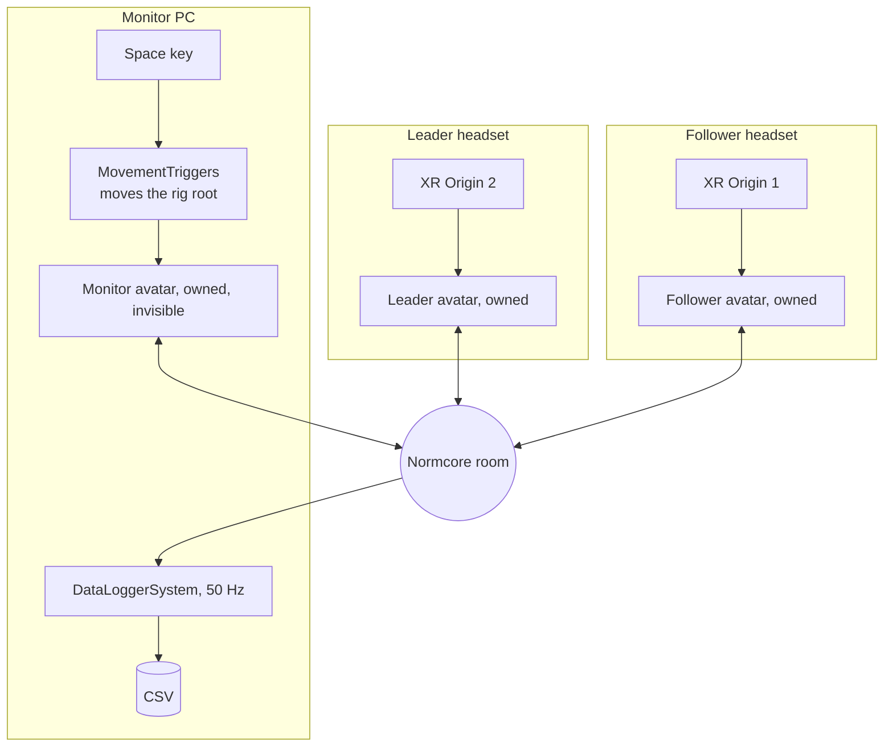
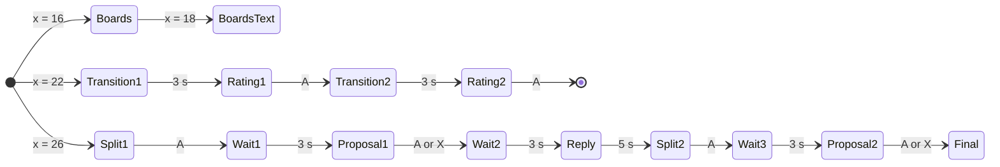

# Architecture

This page describes how Social Leading VR is put together: the roles, the avatar hierarchy, the update order, the coupling maths, networking, the session flow, and the files it writes. For fields and defaults see [COMPONENTS.md](COMPONENTS.md).

## Roles and scenes

Each client opens one scene. The scene fixes the role and the avatar.

| Role | Scenes | Runs on | What it does |
|---|---|---|---|
| Leader | `Scenes/Leader/SLSL_P1` to `SLSL_P5` | Headset | Sends raw poses and voice. The avatar shows the user's own movement. |
| Follower | `Scenes/Follower/SLSF_P1` to `SLSF_P5` | Headset | Sends raw poses and voice. The avatar shows the coupled movement. |
| Monitor | `Scenes/Monitor/Monitor` | PC | Invisible avatar, fixed side camera, Space key, motion log |
| Desktop demo | `Demo/DesktopDemo` | PC | Both avatars in one scene, no network |

P1 to P5 are avatar choices. Any leader scene works with any follower scene, because every avatar prefab is part of every build.

The leader rig stands at (0, 0, -1.5) facing +z. The follower rig stands at (0, 0, 1.5) facing -z. Both rigs use the device tracking origin with a camera offset of 1.6 m.



## Avatar hierarchy

Follower avatar prefab. The leader prefab has only the first six children and the body.

```text
VR Player Complete Prefab Follower Pk     RealtimeView, RealtimeTransform, RealtimeAvatar, GetPartnerTransform
  0  Head                                 raw, synced; RealtimeAvatarVoice
  1  Left Hand                            raw, synced
  2  Right Hand                           raw, synced
  3  Head Partner                         copy of the partner's child 0
  4  Left Hand Partner                    copy of the partner's child 1
  5  Right Hand Partner                   copy of the partner's child 2
  6  Left Hand Partner Slow               SlowFollowSystem on child 4
  7  Right Hand Partner Slow              SlowFollowSystem on child 5
  8  Head Modulated                       head modulators
       Camera Object                      SetCameraParent
  9  Left Hand Modulated                  hand modulators
  10 Right Hand Modulated                 hand modulators
  11 VR Character IK k                    body, IKTargetFollowVRRig
```

**Contract:** `GetPartnerTransform` reads children 0 to 2 and writes children 3 to 5 by index. Keep that order.

The body follows `Head Modulated` and the two `Hand Modulated` objects on the follower, and the raw `Head` and hands on the leader. On the leader, `Camera Object` is a child of `Head`.

Each modulator object carries several modulator components. Only one per object is enabled:

| Object | Enabled in the follower prefabs | Present but disabled |
|---|---|---|
| Head Modulated | `HeadAddedFollowSystem`, ratio 0.3 | `HeadMixedFollowSystem` 0.5, `LocalFollowSystem`, `SlowFollowSystem` 0.5 s |
| Left and Right Hand Modulated | `HandMixedFollowSystem`, ratio 0.3 | `HandAddedFollowSystem` 0.35, `LocalFollowSystem`, `SlowFollowSystem` 0.5 s |
| Left and Right Hand Partner Slow | `SlowFollowSystem`, 0.2 s | |

## Update order

The coupling runs in one chain inside `Update`. Execution orders are set in code with `[DefaultExecutionOrder]`.

| Order | Component | Phase | Step |
|---|---|---|---|
| -100 | `SimulatedRig` | Update | Desktop demo only: writes raw poses |
| -90 | `RealtimeAvatar` (Normcore) | FixedUpdate, Update, LateUpdate | Copies the local XR rig into the raw children |
| -70 | `ModulationProfileApplier` | Update | Writes profile values into the modulators |
| -60 | `GetPartnerTransform` | Update | Finds the partner and copies its raw poses |
| -55 | `SlowFollowSystem` | Update | Low-pass on the partner's hands |
| -50 | `HeadAddedFollowSystem`, `HeadMixedFollowSystem`, `LocalFollowSystem` | Update | Displayed head |
| -45 | `HandMixedFollowSystem`, `HandAddedFollowSystem` | Update | Displayed hands, which need the displayed head |
| 0 | `IKFootSolver`, `MovementStateHandler`, `UIPlayerInput`, others | Update | Feet, session, panels |
| 0 | `IKTargetFollowVRRig` | LateUpdate | Places the body and writes the IK targets |

Animation Rigging evaluates between `Update` and `LateUpdate`. The limbs therefore use the IK targets written in the previous frame.

## Coupling

All modulators work on `localPosition` and `localRotation` under the avatar root. The partner's pose is copied with the same local values, so a movement "forward" in the leader's root space becomes a movement "forward" in the follower's root space, whatever direction the two roots face in the room.

### Link

`GetPartnerTransform` keeps a static list of every avatar that has the component. The list is reset when play starts.

- `sourceTag` empty: the link is active when exactly two avatars are registered.
- `sourceTag` set: the link uses the first registered avatar with that tag. While none is found, it searches twice per second.
- `linkEnabled` off: `HasSource` is false. The modulators then pass the user's own pose through, and the superimposed offsets return to zero at once.

### Heading alignment

`MovementModulator.HeadingAlignment` projects both head directions onto the horizontal plane and returns the rotation around the vertical axis that turns the partner's heading into the own heading. If either head looks straight up or down, the last valid rotation is kept.

### Hands, blend (`HandMixedFollowSystem`)

```text
own     = myHand - myHead
partner = Yaw * (partnerHandSlow - partnerHead)
w       = followRatio * axisRatio                    (per axis, clamped to 0..1)
hand*   = modulatedHead + Lerp(own, partner, w)
```

Ratio 0 leaves the hand alone. Ratio 1 copies the partner's hand. `axisRatio` acts in the follower's root space. With `mirror` on, the partner vector is first reflected left-right in the partner's own heading, and `mirrorPartnerHand` selects which partner hand to read.

### Hands, superimpose (`HandAddedFollowSystem`)

```text
offset += Yaw * (change of (partnerHand - partnerHead)) * addRatio
hand*   = modulatedHead + own + offset               (offset clamped to maxOffset when it is above 0)
```

It reacts to changes and not to absolute position, so the offset can drift. In the prefabs it reads the unfiltered partner hand.

### Position, superimpose (`HeadAddedFollowSystem`)

```text
offset.xz += (change of partnerHead).xz * addRatio
head*      = myHead + offset                         (offset clamped to maxOffset when it is above 0)
```

With a constant ratio the sum equals `addRatio * (partnerHead(t) - partnerHead(t0))`, where `t0` is the first frame of the link. The vertical axis is untouched.

### Position, blend (`HeadMixedFollowSystem`)

```text
head*.xz = Lerp(myHead.xz, partnerHead.xz, followRatio)
head*.y  = myHead.y
```

### Smoothing (`SlowFollowSystem`)

```text
x += (target - x) * (1 - exp(-dt / lerpTime))
```

The filter does not depend on the frame rate. `lerpTime` 0 copies the pose. Only the partner's hands are filtered; the partner's head is not.

### Rotations

Head and hand rotations are always the user's own.

### Profiles

A `ModulationProfile` asset holds one coupling design. `ModulationProfileApplier` writes it into every modulator below it on each frame, so edits apply live. Without an applier, the values in the prefab count. The networked prefabs have no applier.

Some details follow from how the applier writes values:

- Hands off, or one hand off, means ratio 0 on that hand. The component stays enabled, so the displayed hand follows the user's own hand.
- `handAxisRatio` and `partnerSmoothing` affect hands blend only, because hands superimpose reads the unfiltered partner hand.
- `maxPositionOffset` affects position superimpose only. `HandAddedFollowSystem.maxOffset` is set on the component.
- The smoothing value is written to objects whose name contains `Partner Slow`. The left hand is recognised by a name that starts with `Left`.

## Body and camera

`IKTargetFollowVRRig` places the body root under the head target (offset (0, -0.54, 0) in the prefabs), turns it toward the head's yaw, and copies the three tracked poses into the IK targets. `turnSmoothness` is the share of the remaining turn per frame at 90 Hz; the code converts it so that the turn speed is the same at other frame rates. Each body has four two-bone IK constraints (arms and legs) and one multi-parent constraint (head). `IKFootSolver` steps each foot toward a ray-cast point below the body, one foot at a time.

The view of each headset comes from `Camera Local Object`, the only enabled camera that is tagged `MainCamera`. The camera of the XR rig is disabled and only provides tracking. When an avatar is locally owned, `SetCameraParent` attaches the scene camera to `Camera Object`. The follower therefore sees from the coupled head. The script releases the camera when the room disconnects and when the avatar is destroyed. The release was not tested in a networked session.

## Networking

| Item | Value |
|---|---|
| Library | Normcore 2.12.0 |
| App key | `Assets/Normal/Resources/NormcoreAppSettings.asset`, empty in the repository |
| Room | `Test Room`, joined on start (`Realtime` component in the two `Realtime + VR Player Complete Prefab` prefabs) |
| Avatar spawn | `RealtimeAvatarManager` instantiates *Local Avatar Prefab* by name from a `Resources` folder |
| Synced | Root (position, rotation, scale), head and hands (position, rotation), all interpolated; voice from the `Head` object of every avatar, including the monitor |
| Not synced | Coupled poses, panel state, slider values, step index |

The local rig is mapped in each scene: root to the XR Origin, head to `Head VR Target`, hands to `Left Hand VR Target` and `Right Hand VR Target`. The hand targets carry the fixed offset between the controller and the wrist. The head target sits 8 cm below and 2 cm behind the tracked camera.

No first-party script defines a Normcore model. Two first-party scripts use the Normcore API at run time: `SetCameraParent` (ownership check, disconnect event) and `MovementTriggers` (ownership request, only if the rig has a `RealtimeTransform`). The editor script `DesktopDemoBuilder` removes Normcore components from a copy of the prefabs.

## Session flow

The monitor has no message channel of its own. It uses the synced position of its avatar root as the signal.

1. `ObserverController` reads Space and calls `MovementTriggers.MoveToNextPosition`.
2. `MovementTriggers` moves the monitor rig to the next target position. Normcore syncs the root of the monitor avatar.
3. On every client, `MovementStateHandler` on the monitor avatar compares the root with the next target position. On a match it plays the clip with the same index on the scene object named `Audio Source` and advances its own counter. An empty slot is a silent step. On the monitor, `MovementTriggers` starts the clip directly.
4. On the headsets, `UIPlayerInput` compares the same root with four signal positions and opens panels.
5. On the monitor, Space is ignored until the clip has finished. The clip slots are empty in this release.

| Step | Monitor root | Clip slot | Panel on the headsets |
|---|---|---|---|
| 1 to 7 | x = 2, 4, 6, 8, 10, 12, 14 | 1 to 7 | |
| 8 | x = 16 | 8 | Two information boards |
| 9 | x = 18 | 9 | Extra text on the boards |
| 10 | x = 20 | 10 | |
| 11 | x = 22 | 11 | Two rating panels, one after the other |
| 12 | x = 24 | 12 | |
| 13 | x = 26 | 13 | Split panels, two rounds with scripted proposals and a scripted reply after the first |

All positions have y = 0 and z = 1. The monitor rig starts at (0, 0, 1). The three lists (`MovementTriggers`, `MovementStateHandler`, `UIPlayerInput`) must agree. Narration follows the order of the list, so a client that joins after step 1 plays no clips. Panels check each position on its own and do not depend on that order.

## Panels

`UIPlayerInput` sits on `PlayerInputManager` in every leader and follower scene. The panels are world-space canvases. Each client has its own copy and its own answers. The right thumbstick moves the slider, A confirms or accepts, X rejects. The slider reacts to changes of the stick value, so a stick that is held perfectly still does not repeat.



The proposals are fixed texts in the panel prefabs. The reply text depends on the local slider value only: at or above `rejectThreshold` (80) it shows `rejectText`, otherwise `acceptText`. Nothing is exchanged with the other client.

## Files written at run time

All files go to `Application.persistentDataPath` on the client that writes them. No file is uploaded.

| File | Client | Content |
|---|---|---|
| `System_Movement_Tracking_Data/SystemTrackingData_<UTC time>.csv` | Monitor | One row per physics step (50 Hz at the default fixed time step): frame, time, world position and Euler angles of the leader's and follower's raw head and hands, and world position of the follower's displayed head and hands. 47 columns. |
| `SessionSummary_<local time>.csv` | Headsets | Header at start, one row after the last decision. Six columns: two split values, two decisions (`True` or `False`), two ratings. |
| `ResponseLog_<local time>.csv` | Headsets | Header at start, one row per response, written at once: UTC time, scene name, response name, value |

The motion log starts when both avatars are found by tag (`LeaderTag`, `FollowerTag`). It is flushed once per second, on pause, and on quit. Numbers always use a decimal point. A space follows some of the commas, in the header and in the rows, so read the file with, for example, `pandas.read_csv(path, skipinitialspace=True)`. The file prefixes and folders are fields of `DataLoggerSystem` and `UIPlayerInput`.

The displayed poses in the log are the ones computed on the monitor, from the poses it received.

## Desktop demo

`DesktopDemoBuilder` builds the scene from the room and two avatars that keep the hierarchy, modulators, and IK of the networked prefabs. `SimulatedRig` takes the place of the headset and controllers and writes the raw children. `DesktopDemoController` draws the panel and works on a copy of the profile. `RawPoseGhost` draws the markers that show the tracked hands. The leader is avatar P3, the follower is avatar P4. The leader prefab has no modulators, so it shows its own movement.

The menu *Social Leading > Rebuild Desktop Demo* runs the builder again, for example after a change to the avatar prefabs. It opens the monitor scene to take over the room and discards unsaved changes in the open scene, so save first.

## Extension points

| To add | Do this |
|---|---|
| A coupling rule | Derive from `MovementModulator`, use `LinkActive` and `HeadingAlignment`, write the local pose of a `Modulated` object |
| A pose source | Write the three raw children before order -60, as `SimulatedRig` does |
| A transport | Sync the root and the three raw children; replace the two run-time uses of the Normcore API |
| A step | Extend the position and clip lists, and add a check in `UIPlayerInput` |

Recipes: [CUSTOMIZE.md](CUSTOMIZE.md).
